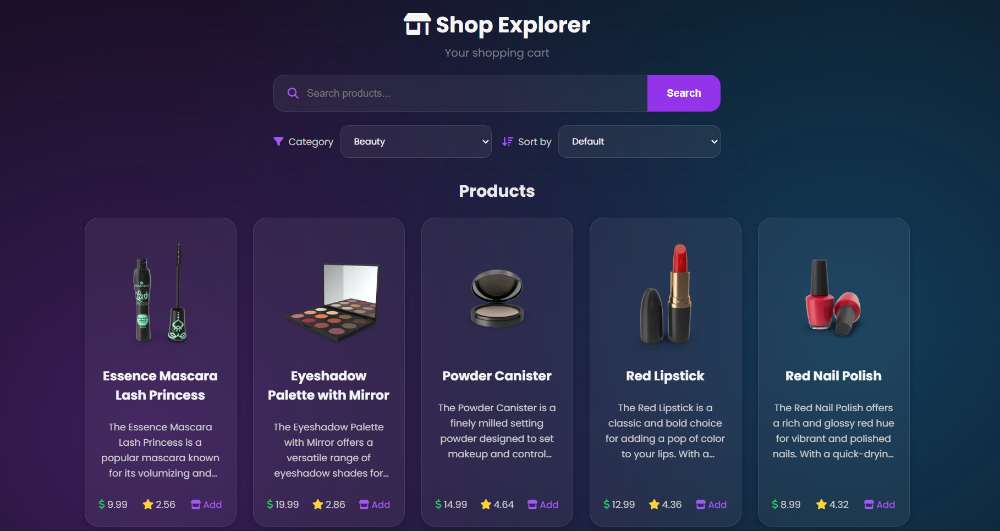
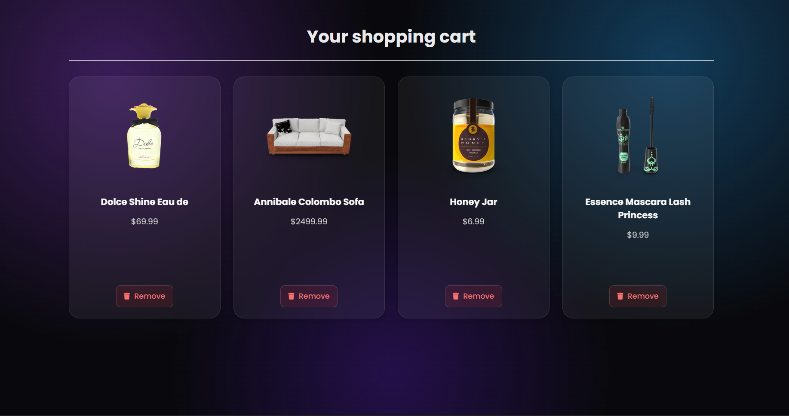

# Shop Explorer 🛍️

A frontend shopping experience built with Vanilla JavaScript, using the DummyJSON Products API to fetch and display products dynamically.

Shop Explorer was built as my **fifth JavaScript project**, continuing my journey from DOM manipulation and local state to working with external APIs and building a more complete frontend experience.

## 🚀 Live Demo

[View Live Demo](#)

## 💻 GitHub Repository

https://github.com/Arvo-parham/Shop-explorer

## 📸 Preview




## ✨ Features

- Fetch products from an external API
- Dynamically render product cards
- Filter products by category
- Sort products by:
  - Price: Low → High
  - Price: High → Low
  - Rating: High → Low
  - Name: A → Z

- Add products to the cart
- Prevent duplicate products from being added
- Persist cart data with Local Storage
- Display cart items on a separate cart page
- Remove products from the cart
- Handle API request errors
- Responsive shopping interface

## 🛠️ Technologies

- HTML5
- CSS3
- Vanilla JavaScript
- Fetch API
- Async/Await
- REST API
- JSON
- Local Storage
- DOM Manipulation
- Event Delegation
- Font Awesome

## 🧠 What I Built

Shop Explorer is a small frontend shopping application that connects to the DummyJSON Products API.

The application has two main parts:

**Products Page**

Users can browse products, filter them by category, sort them using different options, and add products to their cart.

**Cart Page**

Products added to the cart are stored in Local Storage and remain available after refreshing the page. Users can also remove products from the cart.

### Data Flow

```text
DummyJSON API
      ↓
Fetch Products
      ↓
JavaScript State
      ↓
Filter / Sort
      ↓
Dynamic UI
      ↓
Add to Cart
      ↓
Local Storage
      ↓
Cart Page
```

---

# 📚 Case Study

## Problem

After building projects focused on DOM manipulation, state management, asynchronous JavaScript, and API consumption, I wanted to combine these concepts into a more complete frontend application.

Instead of working with a single type of API interaction, this project required managing a collection of products and allowing the user to interact with that data.

The goal was to build something closer to a real-world frontend experience.

## Approach

I separated the application into several responsibilities:

1. Fetch products from the API
2. Store the received products in JavaScript state
3. Render products dynamically
4. Filter products based on category
5. Sort products based on different criteria
6. Add selected products to the cart
7. Store cart data in Local Storage
8. Restore cart data when the application loads
9. Remove products from the cart

This helped me practice keeping application data and UI behavior organized instead of writing everything inside one event handler.

## Implementation

### 1. API Communication

The application fetches product data from DummyJSON using the Fetch API.

```js
const API_URL = "https://dummyjson.com/products";
```

The request is handled asynchronously with `async/await`, and the response is checked before processing the data.

### 2. Dynamic Rendering

Products received from the API are transformed into HTML and rendered dynamically.

Each product contains information such as:

- Image
- Title
- Description
- Price
- Rating
- Add to Cart action

### 3. Filtering

Users can filter products by category.

The original products array is not modified. Instead, a new filtered array is created.

```js
return products.filter((product) => {
  return product.category === category;
});
```

### 4. Sorting

Products can be sorted using several criteria:

- Price ascending
- Price descending
- Rating
- Alphabetical order

A copy of the array is created before sorting:

```js
const sortedProducts = [...products];
```

This prevents the original products state from being directly modified.

### 5. Cart State

The cart is maintained as a JavaScript array.

When a product is added, the application first checks whether it already exists in the cart.

```js
const existingProduct = cart.find((product) => product.id === productId);
```

This prevents duplicate products from being added.

### 6. Local Storage

The cart is persisted using Local Storage.

```js
localStorage.setItem("cart", JSON.stringify(cart));
```

When the application starts, the stored cart is restored:

```js
let cart = JSON.parse(localStorage.getItem("cart")) || [];
```

This allowed me to practice converting JavaScript data to JSON and restoring it back into usable application state.

### 7. Event Delegation

Instead of adding individual click listeners to every dynamically generated button, the application listens for clicks on the parent container.

```js
productsLayout.addEventListener("click", (event) => {
  const addButton = event.target.closest(".addToCart");

  if (!addButton) {
    return;
  }

  // ...
});
```

This is particularly useful because product elements are generated dynamically after the API request.

---

## 🎯 Challenges

One of the main challenges was combining multiple pieces of application logic.

The project required me to think about how:

- API data becomes application state
- State becomes UI
- Filters and sorting operate on that state
- Cart data is stored separately
- Local Storage persists data between sessions
- Dynamically generated elements can still respond to user interactions

Another important challenge was making sure filtering and sorting work together without unnecessarily modifying the original products array.

---

## 📖 What I Learned

Through this project, I strengthened my understanding of:

- Fetch API
- Async/Await
- REST APIs
- JSON data
- Arrays and array methods
- `filter()`
- `sort()`
- `find()`
- `localeCompare()`
- State management
- DOM manipulation
- Dynamic rendering
- Event delegation
- Local Storage
- JSON serialization and parsing
- Separating application responsibilities

More importantly, I started thinking about the application as a combination of **data, state, and UI**, rather than just a collection of individual features.

---

## 🔮 Future Improvements

Possible improvements for a future version:

- Product search
- Product detail page
- Cart quantities
- Total price calculation
- Remove all items
- Product pagination
- Better loading states
- Empty cart state
- More detailed error UI
- Checkout flow
- Improved accessibility
- Better mobile interactions

---

## 🏁 Result

Shop Explorer became my fifth JavaScript project and another step toward building more complete frontend applications.

The project helped me move from individual JavaScript features toward combining **API data, state management, user interactions, filtering, sorting, and persistence** into one application.

This is another step in the Arvo Journey.

**Build. Ship. Evolve.**

---

## 👤 Author

**Arvo — @ArvoParham**

Web • AI • Digital Products

GitHub:
https://github.com/Arvo-parham
